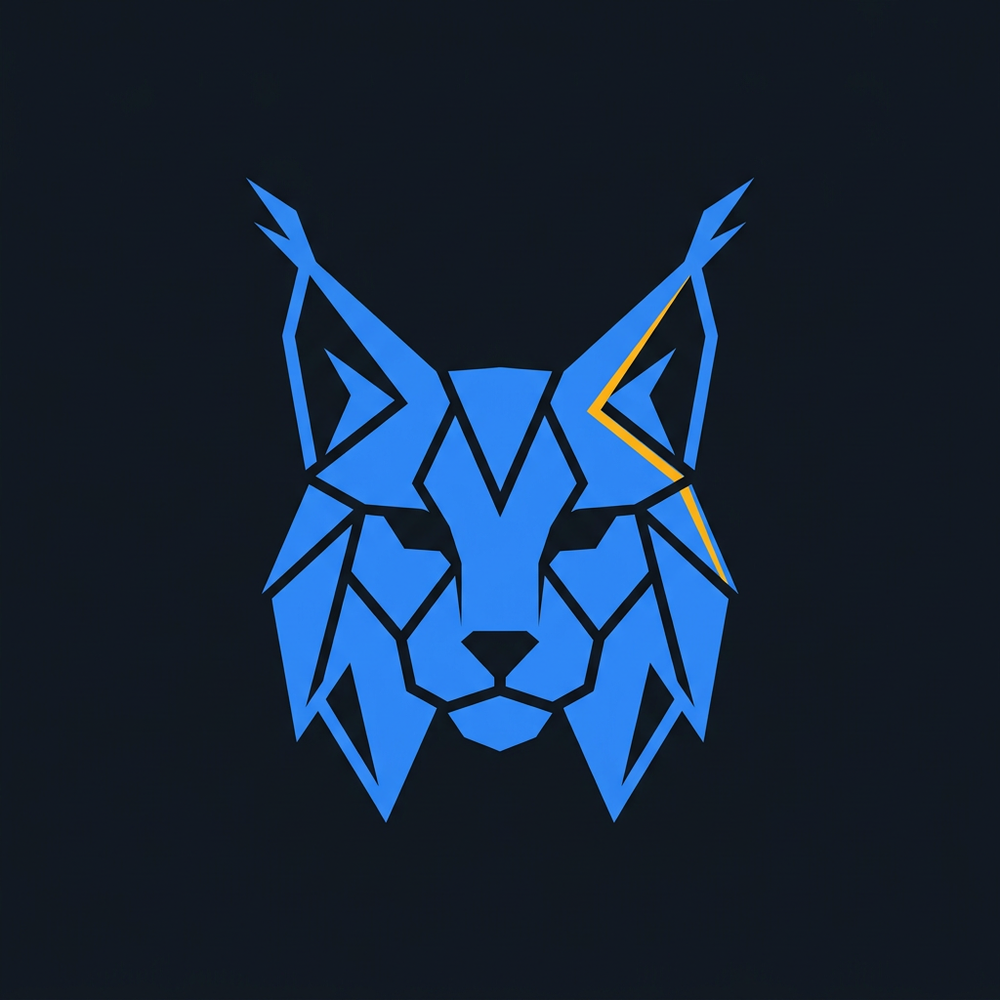
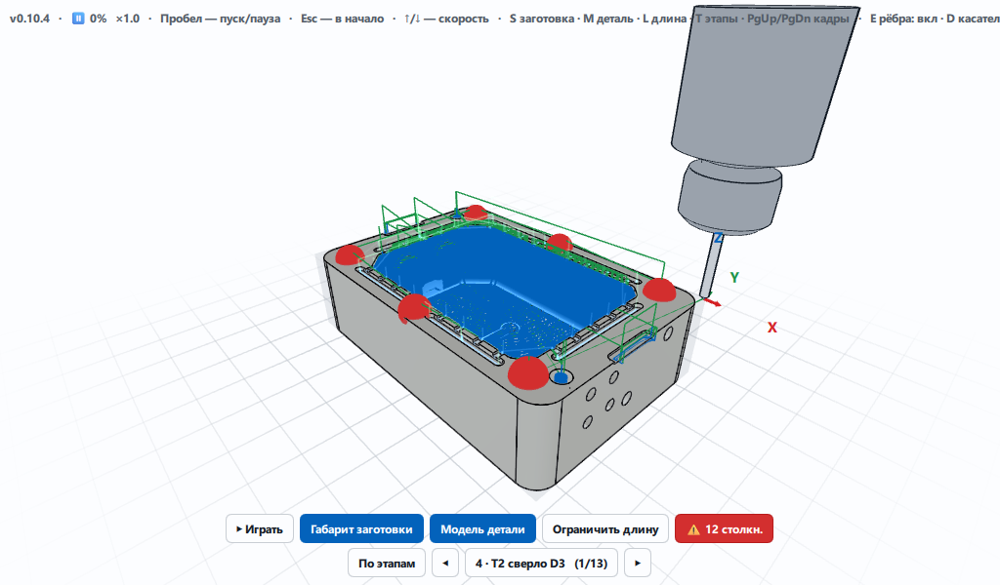
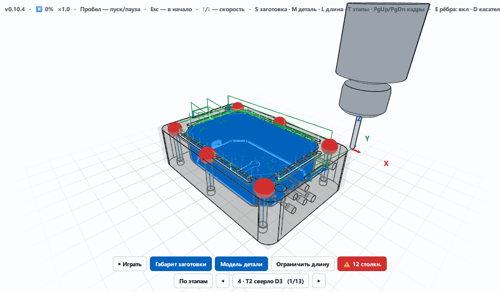

<p align="center">
  
</p>

<h1 align="center">Lynx Touch — CNC Панель оператора</h1>

<p align="center">
  Полноценная панель оператора ЧПУ на дисплеях 7 и 10 дюймов: физический пульт, клавиатура и сенсорный
  экран.<br>
  Внутри — продвинутый 3D-вьювер управляющих программ: траектория, заготовка и деталь, инструмент и
  столкновения до пуска станка.
</p>

<p align="center">
  
  
  
  
</p>

---

## 🎯 О проекте

**Что это.** Lynx Touch — панель оператора ЧПУ целиком, а не экран отдельной программы: рабочее место
оператора с экранами ЧПУ, логикой станка и вьювером УП. Раскладка рассчитана на дисплеи 7 и 10 дюймов;
одна и та же панель работает с физического пульта (клавиатура, клавиши `F1`..`F8`, маховик) и с сенсорного
экрана — вариант переключается на ходу, машина состояний у обоих одна.

**Идея.** Дать оператору ЧПУ наглядный контроль управляющей программы (УП) ещё до пуска станка: увидеть
траекторию в 3D вместе с заготовкой и деталью, проверить инструмент и оправку на столкновения, оценить
съём материала. Всё считается локально, без отправки файлов наружу.

**Цель.** Единая панель оператора, где интерфейс, машина состояний станка и 3D-вьювер УП развиваются
вместе. Интерфейс отрабатывается в React и повторяется в Qt/QML; вьювер — самостоятельный C++-модуль на
QtQuick3D и OpenCASCADE.

**Для кого.** Операторы и наладчики фрезерных станков; инженеры, которым нужен разбор УП и постпроцессора.

**Статус.** Вьювер (`gcode-viewer`) — рабочая C++-программа с настоящей геометрией и аналитикой. Панель
(`react-interface`, `qt-interface`) — проработка интерфейса и логики станка: реального обмена со стойкой
пока нет, машина состояний локальна.

## 🧩 Состав

**Lynx Touch** — продукт из четырёх независимо версионируемых проектов (манифест — [`projects.json`](projects.json)).
Версия продукта — `0.23.0` ([`VERSION`](VERSION)); правила ведения — [`VERSIONING.md`](VERSIONING.md).

| Проект | Версия | Стек | Что это |
|---|---|---|---|
| **react-interface** — [панель оператора](apps/react-interface) | `0.16.0` | Next.js · React · TypeScript | Основной интерфейс: экраны, логика станка, сенсорный и панельный режимы |
| **qt-interface** — [Qt-порт](apps/qt-interface) | `0.5.8` | QML | Перенос интерфейса на Qt/QML (`main.qml`, данные — `preview.qml`) |
| **gcode-viewer** — [3D-вьювер УП](modules/gcode-viewer) | `0.58.6` | QtQuick3D · C++ · OCCT | Траектория, деталь, инструмент, коллизии, поле съёма |
| **cad-testdata** — [тестовые данные](data/cad-testdata) | `0.5.1` | данные · постпроцессор | Тестовые УП/модели и постпроцессор с тегами `UI_*` |

## ✨ Возможности

### 3D-вьювер УП (`gcode-viewer`)

- **Траектория.** G0/G1/G2/G3, циклы сверления; режимы «весь код / ограничить длину».
- **Модель детали.** STEP — `skin` и настоящие B-rep рёбра граней; STL — запасной путь (эвристика по
  двугранному углу).
- **Заготовка.** Габарит и поле съёма материала по тегу `UI_STOCK`.
- **Съём материала.** Поле высот: стекло по умолчанию, виды точный / гладкий / скруглённый, палитра
  пресетов остатка.
- **Инструмент.** Профиль по данным УП (`UI_TOOL`), оправка ER20, вылет из `UI_HOLDER`.
- **Этапы-операции.** Разбиение программы по тегу `UI_OP`, покадровый просмотр.
- **Воспроизведение 1:1.** Скорость по подаче `F`, быстрые ходы — фиксированная скорость; пройденный
  участок скрывается по мере движения.
- **Анализ столкновений.** Оправка против заготовки, с подсветкой опасных участков.
- **Проверка инструмента.** Сверка инструмента УП с таблицей стоек.

### Панель оператора (`react-interface`, `qt-interface`)

- **Два варианта управления.** Экранная панель (софт-кеи) и сенсорный; маршрут `/classic` — всегда
  панельный вариант.
- **Физический пульт.** Клавиатура, клавиши `F1`..`F8`, маховик и аварийный стоп; клавиша и софт-кей шлют
  одно и то же действие, а отключённый кей объясняет причину.
- **Экраны ЧПУ.** Работа, программа, сервис и параметры, наладка, таблицы, тест.
- **Логика станка на чистом TypeScript** (`lib/cnc`): машина состояний, зондирование, оффсеты и WCS,
  инструмент, аварии, MPG, лестница ПЛК (ClassicLadder).
- **Сервисные параметры** через единое описание (`ParamDef`): разделы каталога машины INI, запись, пароль.

## 📸 Скриншоты

<p align="center">
  
  &nbsp;
  
</p>

## 🚀 Быстрый старт

### React-интерфейс

```bash
pnpm install
pnpm dev
```

### 3D-вьювер (C++)

Нужны: Qt 6 (Core, Gui, Qml, Quick, Quick3D), OCCT с CMake-пакетом, CMake не ниже 3.16, Ninja и компилятор
C++17. Каталоги задают переменные `CNC_QT_DIR` и `CNC_OCC_DIR` (не заданы — сборка ищет их сама).

Windows:

```powershell
powershell -NoProfile -ExecutionPolicy Bypass -File scripts/build-viewer.ps1
$env:PATH = "C:\Qt\6.12.0\msvc2022_64\bin;$env:PATH"   # Qt должен быть в PATH до старта
build\viewer\gcodeviewer.exe data\cad-testdata\Test_model.ngc
```

Linux (окружение из [`environment.yml`](environment.yml), всё одним шагом — `bash scripts/setup-env.sh`):

```bash
bash scripts/build-viewer.sh
./build/viewer/gcodeviewer data/cad-testdata/Test_model.ngc
```

Ключи: `gcodeviewer [--smoke] [--frame <файл.png>] [путь к УП]` (`-h` печатает строку запуска). Признаки
успеха: живое окно печатает `loaded g-code from: … segments: N` и ни одной строки `[QML warning]`;
`--smoke` — `RESULT: OK (parse-level)`.

<details>
<summary>Клавиши вьювера</summary>

- `Пробел`/`P` — пуск/пауза, `Esc` — в начало, `вверх`/`вниз` — скорость;
- `S` — габарит заготовки, `M` — вид детали (сплошная -> прозрачная -> скрыта), `K` — skin детали, `G` — линии УП;
- `V` — заготовка стеклом, `B` — прежняя коробка, `C` — палитра остатка, `R` — вид остатка;
- `L` — весь код / ограничить длину, `T` — этапы, `PgUp`/`PgDn` — кадры этапов;
- `E` — рёбра B-rep, `D` — касательные, `Q` — уровень качества, `F` — счётчик FPS.

Буквы работают и на русской раскладке (сверяются по скан-коду). Подробности — [`DESIGN.md`](DESIGN.md).
</details>

## 🏗️ Архитектура

- **`react-interface`**: `components/cnc/` — представление, `lib/cnc/` — чистая логика станка (без JSX/React/DOM).
- **`gcode-viewer`**: чистое ядро `cpp/core/` (парсер, геометрия, поле съёма) -> контроллер `MockBackend` ->
  QML-сцена -> GPU. Разбор УП идёт на рабочем потоке и возвращается сигналами.
- **Контракт с CAD/постпроцессором** — теги `UI_*` в комментариях УП.

Полная карта — [`ARCHITECTURE.md`](ARCHITECTURE.md); устройство вьювера — [`DESIGN.md`](DESIGN.md).

## 🗺️ Планы на будущее

Бэклог идей функционала — [`docs/IDEAS.md`](docs/IDEAS.md). Основные направления:

- **Интерактив по 3D:** привязка обмера по клику на модель, визуальный diff версий УП, правка перебегов,
  выборочная обработка по 3D-рамке.
- **Предиктивная аналитика:** тепловая карта нагрузки, авто-оптимизация подач, учёт ресурса инструмента по
  снятому объёму.
- **Симуляция и безопасность:** «призрак» будущего положения инструмента, проверка заметаемого объёма по
  быстрым ходам, точный предсказатель времени.
- **Оснастка и измерения (КИМ):** привязка моделей оснастки, карта отклонений по обмеру детали.
- **Защита от человеческого фактора:** безопасный рестарт «с указанной точки», история оффсетов (Ctrl+Z),
  мастер выхода из аварии.

## 📚 Документация

- [`ARCHITECTURE.md`](ARCHITECTURE.md) — карта модулей и слоёв (есть английское зеркало [`ARCHITECTURE.en.md`](ARCHITECTURE.en.md))
- [`DESIGN.md`](DESIGN.md) — устройство 3D-вьювера ([`DESIGN.en.md`](DESIGN.en.md))
- [`VERSIONING.md`](VERSIONING.md) — версии и порядок внесения изменений
- [`CLAUDE.md`](CLAUDE.md) — стандарты разработки
- [`AI_WORKFLOW.md`](AI_WORKFLOW.md) — роли ИИ-агентов, иерархия и цикл задачи
- [`ROLES.md`](ROLES.md) — шпаргалка по ролям для распорядителя
- [`docs/ROADMAP.md`](docs/ROADMAP.md) — дорожная карта к Alpha 1/2, Qt и натурному стенду
  ([`docs/ROADMAP.en.md`](docs/ROADMAP.en.md))
- [`.opencode/skills/`](.opencode/skills/) — ролевые скилы (менеджер, архитектор, исполнитель, UI,
  интегратор, тестировщик, ревьюер, технолог ЧПУ) и чек-листы панели и вьювера
- [`.opencode/agents/`](.opencode/agents/) — четыре профиля агентов: `lead`, `builder`, `product-ux`,
  `verifier`; вы говорите только с `lead`
- [`TODO.md`](TODO.md) — технический долг
- [`docs/`](docs/README.md) — планы и исследования; идеи — [`docs/IDEAS.md`](docs/IDEAS.md)
- [`CHANGELOG.md`](CHANGELOG.md) — журнал изменений

## 🧱 Требования

- **Панель:** дисплей 7 или 10 дюймов; физический пульт либо сенсорный экран — или оба сразу.
- **React-интерфейс:** Node.js и `pnpm`.
- **Вьювер:** Qt не ниже 6.7 (проект документирует 6.12.0), OCCT (проект документирует 8.0.1), CMake 3.16+,
  Ninja, компилятор C++17.
- **Платформы:** Windows, Linux.

## 📄 Лицензия

Apache License 2.0 — см. [`LICENSE`](LICENSE).
